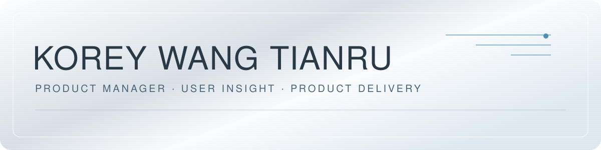

# KOREY WANG TIANRU

**产品经理｜用户研究 · Agent 工作流 · 产品交付**

[作品集](https://korey2028.tech/) · [简历与项目速读](https://korey2028.tech/resume.html) · [公开小工具](#公开小工具)

天津师范大学英语师范专业，2027 届。

我做过健身教练和剧本杀 DM，也在做自己的工具。下面几个项目分别来自训练、备考和门店工作，都是我自己用得上的东西。

我喜欢先做出来，亲自用一用，看看哪里还不顺手，再继续改。

## 项目展示

- **Fitness OS｜训练与饮食记录工具**：[查看产品案例](https://korey2028.tech/work/fitness-os.html)
- **专四备考工作台｜练习与复习工具**：[查看产品案例](https://korey2028.tech/work/tem4.html)
- **DM 角色手册｜备场与临场查阅工具**：[查看产品案例](https://korey2028.tech/work/dm-rehearsal.html)

## 最近在做的东西

### Fitness OS · 把训练记录放到一起

做教练和自己训练时，我需要一起回看训练、饮食和身体状态。我做了 Fitness OS，按“今天、记录、历史、复盘”组织页面，也设计了输入后先确认日期和保存位置的步骤。

我负责需求、页面和操作流程，使用 Agent 辅助实现。目前有 iOS 演示和公开网页版，两版功能有所区别。

[打开 Fitness OS](https://korey2028.tech/work/fitness-os.html)

### 专四备考工作台 · 自己是第一个使用者

备考时，资料和练习入口太散。我把它们放到一个网页里，加入提交反馈和错题复习。在这段备考过程中，我两次正式专四考试的成绩从 **53 分提高到了 69 分**。

后来又补了考试日期、目标分和每天能学多久的设置。重考时还可以填各部分的估分，帮助判断下一步先练哪里。

[打开备考工作台](https://korey2028.tech/work/tem4.html)

### DM 角色手册 · 从自己备场，到同事复用

准备《壁上观》胡不为角色时，我需要弄清每一幕什么时候上场、做什么、说什么，于是把资料整理成 132 页演员手册和 34 页上场朗读本。

**门店老板后来把手册转给了其他 DM 复用。** 我负责资料整理、查阅顺序和展示页面，原剧本及角色非本人原创。

[查看手册展示](https://korey2028.tech/work/dm-rehearsal.html)

## 数据成果

内容累计 **2.17K+ 粉丝**；单条内容最高 **31 万+播放**，单条内容最高 **4.1 万+点赞**。

## 公开小工具

除了上面的产品实践，我也把具体问题整理成可以复用的工具：

| 项目 | 解决的问题 | 可以查看的实现 |
| --- | --- | --- |
| [Storage Analyzer](https://github.com/korey2028-prog/storage-analyzer) | 本地 HTML 报告在微信预览中空白或错位 | Python 扫描、生成期静态渲染、移动端兼容与降级处理 |
| [DOCX Misaligned Columns Fix](https://github.com/korey2028-prog/docx-misaligned-columns-fix) | Word 里用 Tab 和空格排出的选项列容易错位 | 固定列宽表格、字体测宽、保存后修补与文档差异核验 |
| [Life Compound OS](https://github.com/korey2028-prog/life-compound-os) | 学习、训练与日常复盘分散在不同入口 | 无登录的静态 MVP、浏览器本地记录与 Markdown 导出 |

这些仓库可以查看源码；上面的三个代表作品以演示和案例为入口，不代表全部原始资料或实现都已开源。

## 想继续做什么

我希望继续作为产品经理，把真实场景中的问题推进为可用、可验证的产品，也想在多人协作中承担更完整的需求、取舍与交付责任。

[联系我](mailto:korey2028@gmail.com)

